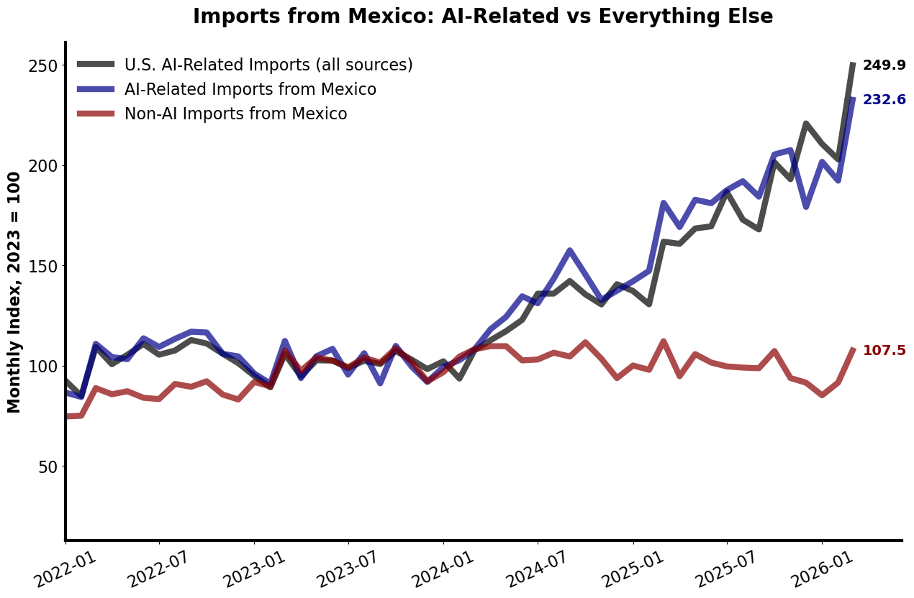
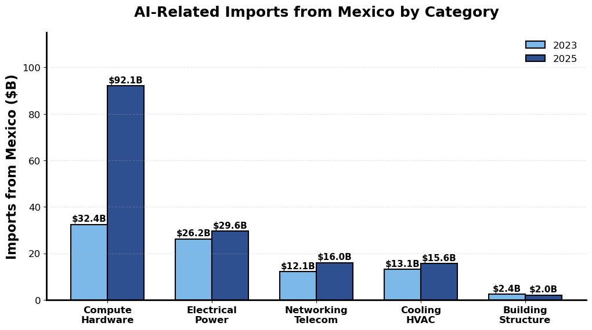
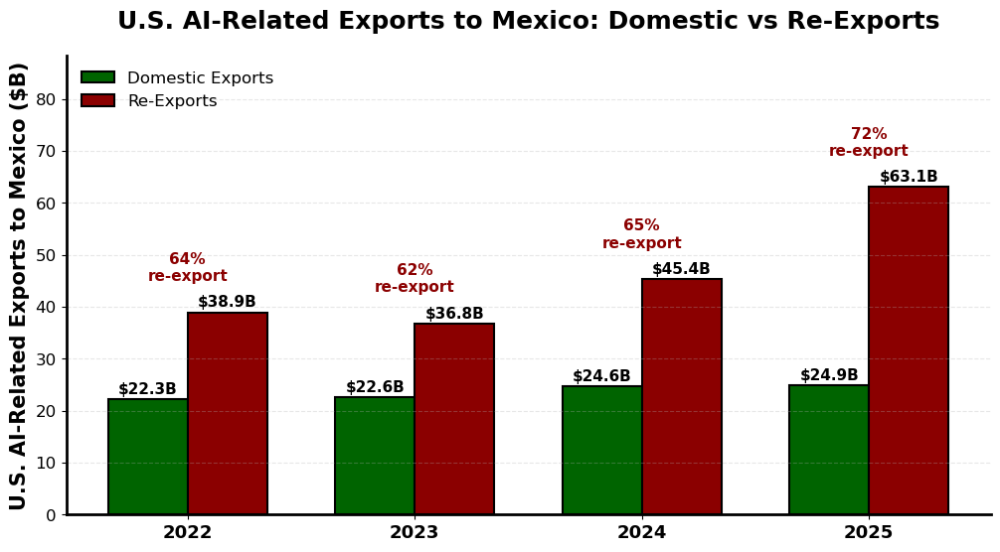
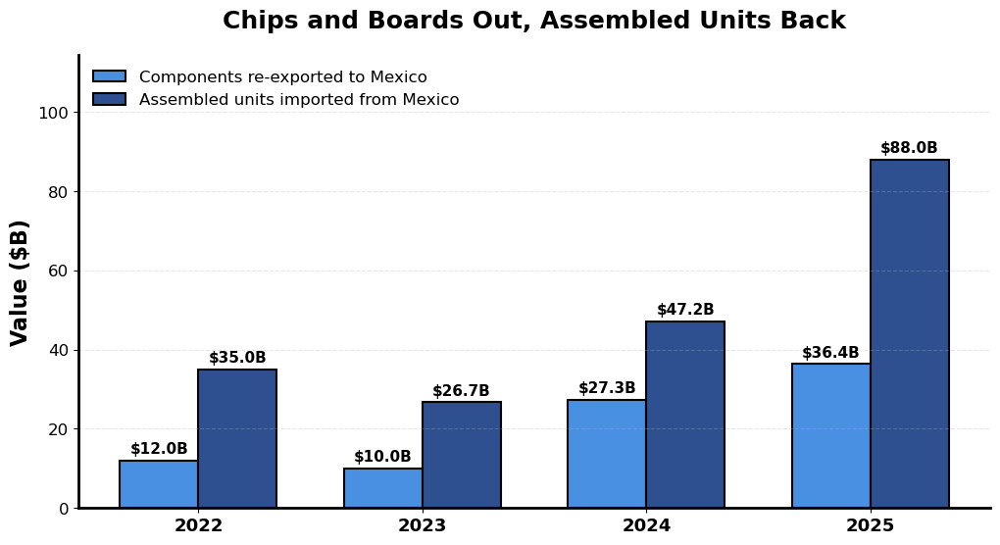
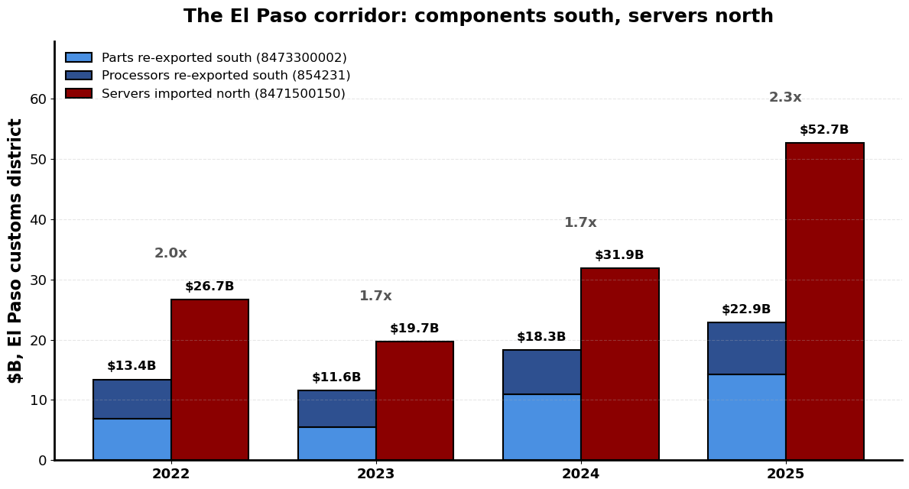

# Mexico and Trade in AI-Related Products

A companion deep dive to [Trade in AI-Related Products](paper/ai-trade.pdf). The paper establishes that Mexico is one of the two countries that dominate U.S. trade in AI-related products. This document asks what exactly Mexico ships, how that has changed since 2023, and what the domestic-versus-re-export split says about what Mexico is actually doing.

All numbers use the paper's classification and conventions: high-relevance HS10 codes from the LLM classifier, HS chapters 27, 71, 98, and 99 excluded, Census monthly trade data through **March 2026**. Sections 1 through 4 and 6 through 7 are regenerated by [code/mexico-deepdive.py](code/mexico-deepdive.py); the border-crossing detail in Section 5 comes from [code/mexico-ports.py](code/mexico-ports.py).

---

## Summary

1. **Mexico's AI-related shipments to the U.S. grew 80 percent between 2023 and 2025**, from $86.5B to $155.7B, while everything else Mexico sends the U.S. was flat ($345.6B to $344.8B). AI-related goods went from a fifth of what Mexico sells the U.S. to nearly a third, and to 35 percent in the first quarter of 2026.

2. **Mexico supplied a quarter of the entire increase in U.S. AI-related imports.** Of the $275B rise between 2023 and 2025, Taiwan accounts for $112.5B (41 percent) and Mexico for $69.2B (25 percent). No one else is close.

3. **The growth is one product.** HS10 `8471500150`, processing units, went from $25.0B to $80.6B and now accounts for 52 percent of everything AI-related Mexico ships. That single code is 80 percent of Mexico's AI growth and **20 percent of the entire U.S. AI import increase**.

4. **But Mexico's breadth is real outside compute.** Mexico is the number one U.S. source for Electrical Power (21 percent), Cooling HVAC (33 percent), Building Structure (20 percent), and Fire Safety (64 percent), and number two in Compute Hardware behind Taiwan. Taiwan is a chip story; Mexico is a chip story *and* an everything-else-in-the-building story.

5. **Nearly three-quarters of what the U.S. sends Mexico is not made in the U.S.** Re-exports were 72 percent of U.S. AI-related exports to Mexico in 2025, rising to 81 percent in early 2026. Domestic AI exports to Mexico grew 10 percent since 2023; re-exports grew 71 percent.

6. **The traffic pattern is chips and boards out, assembled units back.** The U.S. re-exported $36.4B of components to Mexico in 2025 (parts for data-processing machines, CPUs, SSDs) and imported $88.0B of assembled units back. CPUs alone: $7.9B re-exported to Mexico in 2025, up from nothing in 2023.

7. **The round trip happens in one corridor.** In 2025, 73 to 97 percent of the components re-exported to Mexico left through the El Paso district, and 65 percent of the servers came back through the Juárez bridges of that same district: $22.9B south against $52.7B north, within a few miles. That ratio has held between 1.7 and 2.3 every year since 2022. Crossings are now shifting toward Laredo as capacity moves to central Mexico.

8. **Ninety percent of the widening U.S.-Mexico goods deficit since 2023 is AI-related.** The bilateral deficit grew $45.0B; the AI-related component of it grew $40.5B. The non-AI deficit is essentially where it was in 2023.

9. **The tariff story is why this kept working.** Mexican AI-related goods faced a 1.9 percent effective rate in December 2025 against 6.1 percent for Mexican non-AI goods, and compute hardware from Mexico faced 0.3 percent.

---

## 1. How big, and how fast



The divergence starts in early 2024, the same timing the paper documents for AI-related imports overall. What is striking is the contrast *within* Mexico: AI-related shipments run at 233 (2023 = 100) by March 2026 while low-relevance shipments, the red line in the figure, sit at 108. Mexico's headline export growth to the U.S. is almost entirely an AI-related phenomenon.

| Year | AI-related ($B) | Everything else ($B) | Total ($B) | *of which:* Low relevance | *Medium* | *Unclassified* | AI as % of Mexico's shipments | Mexico as % of U.S. AI imports |
|---|---:|---:|---:|---:|---:|---:|---:|---:|
| 2022 | 91.5 | 318.5 | 410.0 | 254.9 | 45.3 | 18.3 | 22.3 | 23.2 |
| 2023 | 86.5 | 345.6 | 432.1 | 300.0 | 45.6 | 0.0 | 20.0 | 22.8 |
| 2024 | 110.6 | 359.7 | 470.3 | 313.5 | 46.2 | 0.0 | 23.5 | 23.7 |
| 2025 | 155.7 | 344.8 | 500.5 | 300.4 | 44.4 | 0.0 | 31.1 | 23.8 |
| 2026 Q1 | 45.2 | 82.9 | 128.1 | 71.1 | 10.8 | 1.1 | 35.3 | 21.6 |

"Everything else" is the total minus AI-related, and it splits three ways: Low-relevance codes, the Medium-relevance codes the classifier neither included nor ruled out, and codes carrying no classification at all. The middle column matters because AI-related plus Low relevance does *not* add to the total | the roughly $45B Medium bucket sits between them. The unclassified column is the 2022 caveat: $18.3B, 4.5 percent of that year's value, sits on HS10 codes that had been retired before the classification files were built, so 2022 AI-related trade is understated by an unknown fraction of that.

Growth rates: **+27.9 percent** in 2024, **+40.7 percent** in 2025, **+79.9 percent** over the two years together. In the first quarter of 2026 Mexican AI shipments were up 33 percent year over year, though for the first time they grew more slowly than U.S. AI imports overall (up 54 percent), as Taiwan accelerated.

Note that Mexico's share of U.S. AI-related imports is remarkably *stable* at roughly 23 to 24 percent even as the level nearly doubled. Mexico grew with the boom rather than gaining or losing ground in it. (The paper reports this share as about 25 percent; that figure uses the 30 countries in the country-level file as the denominator, while the 23.8 percent here uses all U.S. imports.)

## 2. What Mexico actually ships



| Category | 2023 ($B) | 2025 ($B) | Change (%) | Share of Mexico's AI (%) | Mexico's share of U.S. imports, 2025 (%) | U.S. category growth (%) |
|---|---:|---:|---:|---:|---:|---:|
| Compute Hardware | 32.4 | 92.1 | +184.4 | 59.1 | 26.0 | +144.9 |
| Electrical Power | 26.2 | 29.6 | +12.7 | 19.0 | 20.9 | +21.3 |
| Networking Telecom | 12.1 | 16.0 | +32.4 | 10.3 | 16.0 | +58.2 |
| Cooling HVAC | 13.1 | 15.6 | +19.2 | 10.0 | 32.8 | +14.4 |
| Building Structure | 2.4 | 2.0 | -16.7 | 1.3 | 20.1 | -16.5 |
| Fire Safety Security | 0.3 | 0.5 | +35.4 | 0.3 | 63.6 | +10.5 |

Two things stand out.

**The composition tilted hard toward compute.** Compute hardware was 37 percent of Mexico's AI-related shipments in 2023 and is 59 percent in 2025 (62 percent in early 2026). The non-compute categories grew, but at rates in the teens and twenties, roughly in line with U.S. imports of those categories from everywhere.

**Mexico's position is strongest in the unglamorous categories.** Ranked by Mexico's share of U.S. imports in each category, 2025:

| Category | Mexico's rank | Top three sources | Country file covers |
|---|:--:|---|:--:|
| Fire Safety Security | 1 | Mexico 63.6%, Malaysia 13.3%, China 7.2% | 99% |
| Cooling HVAC | 1 | Mexico 32.8%, China 12.7%, Canada 8.0% | 95% |
| Building Structure | 1 | Mexico 20.1%, Canada 14.9%, China 8.9% | 81% |
| Electrical Power | 1 | Mexico 20.9%, China 14.2%, Canada 6.9% | 90% |
| Compute Hardware | 2 | Taiwan 41.2%, Mexico 26.0%, Thailand 5.7% | 97% |
| Networking Telecom | 3 | Vietnam 26.5%, Thailand 18.6%, Mexico 16.0% | 96% |

Shares here divide by *total* U.S. imports in the category, the same denominator as the table above, so Mexico's number is identical in both places. The ranks, however, can only be taken over the 30 countries in the country-level file, and the last column says how much of the category that file sees. The gap never threatens a rank: the tightest case is Building Structure, where everything the file does not cover comes to $1.9B against Mexico's $2.0B, so no absent country can displace Mexico even if it were the entire remainder.

This is the point the paper makes about why a broad classification matters, seen from the Mexican side. A semiconductor-only view of AI trade would classify Mexico as a secondary player. On the equipment that goes into the building rather than the rack, Mexico is the single largest supplier the U.S. has.

### Top 15 AI-related products imported from Mexico, 2025

| HS10 | Description | Category | 2023 ($B) | 2025 ($B) | Change (%) | Share of Mexico's AI (%) | Mexico's share of U.S. imports (%) |
|---|---|---|---:|---:|---:|---:|---:|
| 8471500150 | Processing units | Compute Hardware | 25.0 | 80.6 | +222 | 51.7 | 49.3 |
| 8517620090 | Voice/image/data reception equipment, nesoi | Networking Telecom | 4.8 | 6.5 | +34 | 4.1 | 12.2 |
| 8517620020 | Switching and routing apparatus | Networking Telecom | 3.5 | 5.0 | +41 | 3.2 | 16.1 |
| 8537109170 | Electrical apparatus, under 1000V, nesoi | Electrical Power | 4.7 | 4.8 | +2 | 3.1 | 42.5 |
| 8471709000 | Other storage units | Compute Hardware | 1.3 | 3.4 | +155 | 2.2 | 80.7 |
| 8473301180 | Parts for ADP machines, printed circuit assemblies | Compute Hardware | 0.3 | 2.5 | +626 | 1.6 | 5.1 |
| 8415908085 | Parts of air conditioning machines | Cooling HVAC | 2.5 | 2.2 | -11 | 1.4 | 59.3 |
| 8544429090 | Insulated conductors with connectors | Electrical Power | 1.7 | 1.9 | +16 | 1.2 | 39.7 |
| 8537109160 | Programmable controllers | Electrical Power | 1.5 | 1.8 | +19 | 1.2 | 44.4 |
| 8544700000 | Insulated optical fiber cables | Networking Telecom | 1.1 | 1.8 | +60 | 1.1 | 46.1 |
| 8418690180 | Refrigerating/freezing equipment | Cooling HVAC | 0.8 | 1.6 | +108 | 1.0 | 60.1 |
| 8415908065 | Parts of heat pumps | Cooling HVAC | 0.8 | 1.5 | +83 | 1.0 | 42.2 |
| 8471804000 | Units for incorporation into ADP machines | Compute Hardware | 0.0 | 1.4 | n.m. | 0.9 | 12.5 |
| 7308909590 | Structures and parts, iron or steel | Building Structure | 1.2 | 1.2 | -1 | 0.8 | 30.9 |
| 8537109150 | Panel boards and distribution boards | Electrical Power | 0.8 | 0.9 | +18 | 0.6 | 52.3 |

Look down the last column. On a dozen of these codes Mexico supplies 40 to 80 percent of everything the United States buys from the world. Air conditioning parts, refrigeration equipment, panel boards, programmable controllers, optical fiber cable, storage units: for the physical plant of a data center, the U.S. supply chain runs through Mexico.

### The concentration problem

Mexico's AI-related trade is more concentrated in a single code than Taiwan's, though less concentrated across the top five:

| Source | 2025 AI imports ($B) | Codes | Top 1 (%) | Top 5 (%) | HHI |
|---|---:|---:|---:|---:|---:|
| Mexico | 155.7 | 557 | 51.7 | 64.4 | 2,737 |
| Taiwan | 160.8 | 525 | 42.7 | 79.1 | 2,516 |
| China | 42.0 | 613 | 24.4 | 46.6 | 811 |

Of Mexico's $69.2B increase in AI-related shipments from 2023 to 2025, $55.6B is code `8471500150` alone | 80 percent of the total. The next largest contributor adds $2.2B. Mexico's AI trade story is one very large product and a long, broad tail.

## 3. The other direction: what the U.S. sends Mexico



| Year | Total ($B) | Domestic ($B) | Re-exports ($B) | Re-export share (%) | AI as % of exports to Mexico, ex-chapter | *same, all chapters* |
|---|---:|---:|---:|---:|---:|---:|
| 2022 | 61.2 | 22.3 | 38.9 | 63.6 | 23.7 | *18.7* |
| 2023 | 59.3 | 22.6 | 36.8 | 62.0 | 22.2 | *18.3* |
| 2024 | 70.0 | 24.6 | 45.4 | 64.8 | 24.8 | *21.0* |
| 2025 | 88.0 | 24.9 | 63.1 | 71.7 | 30.3 | *26.0* |
| 2026 Q1 | 32.8 | 6.3 | 26.6 | 80.8 | 40.1 | *35.2* |

The last two columns differ because chapters 27, 71, 98, and 99 are excluded throughout this document, and chapter 27 alone is $37.4B of what the U.S. sold Mexico in 2025. The ex-chapter column is the one consistent with the paper; the all-chapter column is the one comparable to published totals. Both tell the same story, and the rest of this section uses the ex-chapter convention.

Between 2023 and 2025, total AI-related exports to Mexico grew 48 percent. Decomposed: **domestic exports grew 10.5 percent, re-exports grew 71.4 percent.** Essentially all of the growth in what the U.S. "exports" to Mexico in AI-related products is foreign-made goods passing through.

By category, the re-export share tracks how tradeable and how foreign-sourced the product is:

| Category | 2025 exports to Mexico ($B) | Re-exports ($B) | Re-export share 2025 (%) | Re-export share 2023 (%) | Growth 2023-25 (%) |
|---|---:|---:|---:|---:|---:|
| Compute Hardware | 53.1 | 49.0 | 92.4 | 87.7 | +92.6 |
| Electrical Power | 22.2 | 7.9 | 35.6 | 38.1 | +6.5 |
| Networking Telecom | 6.3 | 4.5 | 71.0 | 69.0 | +35.6 |
| Cooling HVAC | 5.6 | 1.5 | 26.3 | 24.2 | +2.4 |
| Building Structure | 0.7 | 0.1 | 14.2 | 15.4 | -9.1 |

Compute hardware sent to Mexico is 92 percent foreign-origin. Cooling and electrical equipment, which is heavier, more customized, and more likely to be genuinely made in the United States, is 26 to 36 percent re-export and grew barely at all.

## 4. The round trip



The largest single item the U.S. re-exports to Mexico is `8473300002`, parts and accessories for data-processing machines: **$19.5B in 2025, up from $6.5B in 2023, and 95.5 percent of it re-export.** Second is `8542310045`, central processing units, at $7.9B in 2025 against essentially zero in 2023.

The round trip is measured with two hand-picked baskets of HS10 codes, listed in full below so that the two bars in the figure can be read off the tables. The **component basket** is what the U.S. re-exports south; the **unit basket** is what comes back north. The two are disjoint, and neither is simply "the largest re-export codes" | `8471500150` and `8517620085` are large re-exports that belong to the unit basket and to neither basket respectively.

**Component basket.** U.S. re-exports to Mexico, $B:

| HS10 | Description | 2023 | 2025 | Re-export share of code, 2025 (%) |
|---|---|---:|---:|---:|
| 8473300002 | Parts and accessories for machines of 8471 | 6.54 | 19.51 | 95.5 |
| 8542310045 | Central processing units (CPUs) | 0.00 | 7.90 | 99.0 |
| 8523510000 | Solid-state non-volatile storage | 2.69 | 4.88 | 95.8 |
| 8471704065 | Hard disk drive units | 0.52 | 1.66 | 99.7 |
| 8542310050 | Other processors, including microprocessors | 0.00 | 1.09 | 98.2 |
| 8542390060 | Electronic integrated circuits, nesoi | 0.00 | 0.60 | |
| 8542310075 | Processors and controllers, not combined with memory | 0.00 | 0.46 | |
| 8542320070 | Integrated circuits, memory, nesoi | 0.11 | 0.23 | |
| 8542330000 | Integrated circuits, amplifiers | 0.13 | 0.10 | |
| 8542310040 | Graphics processing units (GPUs) | 0.00 | 0.00 | |
| **Total** | | **9.99** | **36.43** | |

**Unit basket.** U.S. imports from Mexico, $B:

| HS10 | Description | 2023 | 2025 |
|---|---|---:|---:|
| 8471500150 | Processing units | 24.99 | 80.55 |
| 8471709000 | Other storage units | 1.34 | 3.42 |
| 8473301180 | Parts for ADP machines, printed circuit assemblies | 0.34 | 2.49 |
| 8471804000 | Units for incorporation into ADP machines | 0.00 | 1.39 |
| 8471809000 | Other ADP units | 0.07 | 0.09 |
| **Total** | | **26.75** | **87.95** |

Those two totals are the figure:

| Year | Components re-exported to Mexico ($B) | Assembled units imported from Mexico ($B) | Ratio |
|---|---:|---:|---:|
| 2022 | 12.0 | 35.0 | 2.9 |
| 2023 | 10.0 | 26.8 | 2.7 |
| 2024 | 27.3 | 47.2 | 1.7 |
| 2025 | 36.4 | 88.0 | 2.4 |

Note how little the GPU code carries: $2M re-exported to Mexico in 2025, against $7.9B of CPUs. Graphics processors reach Mexican assembly lines already mounted on the board assemblies of `8473300002`, not as standalone GPUs, which is part of why that parts code is two and a half times the size of the CPU code.

Both sides of the round trip roughly tripled between 2023 and 2025. Of the 448 high-relevance codes the U.S. re-exported to Mexico in 2025, 309 came back under the same code. (That count compares export-side high-relevance codes against import-side ones, and the two are classified separately, so it understates the overlap slightly.)

The CPU line is the cleanest illustration of the mechanism. The U.S. re-exported $7.9B of CPUs to Mexico in 2025 and imported essentially none back under that code, while imports of processing units, code `8471500150`, rose $55.6B. Chips go south as chips; they come north inside servers.

Two cautions on reading the gap between the columns as Mexican value added. First, Mexico sources components directly from Asia as well, so U.S. re-exports are only part of the input flow, and industry evidence in Section 8 suggests they are the smaller part. Second, the code groupings here are hand-picked to trace one mechanism, not a full input-output accounting. What the table supports is the direction and the scale, not a value-added number.

One notable feature: **round-trip intensity is stable.** Every dollar of AI-related imports from Mexico has been matched by 41 to 43 cents of AI-related re-exports to Mexico in every year since 2022. Mexico's AI-related trade with the U.S. scaled up without changing character. The 2026 Q1 reading of 59 cents is the first break in that pattern and worth watching.

## 5. Where it crosses

Census reports the port and customs district of every shipment, which locates the round trip in space. Components leave for Mexico through one district, and servers come back through the bridges of that same district a few miles away.



### Components out

U.S. re-exports to Mexico, by district of exit, $B:

| Exit district | 2022 | 2023 | 2024 | 2025 | 2026 Q1 |
|---|---:|---:|---:|---:|---:|
| **Parts for ADP machines (8473300002)** | | | | | |
| El Paso | 6.82 | 5.44 | 10.91 | 14.26 | 11.19 |
| Laredo | 0.36 | 0.39 | 0.84 | 2.00 | 2.52 |
| Los Angeles | 0.08 | 0.12 | 0.25 | 2.16 | 0.38 |
| *El Paso share* | *84%* | *83%* | *88%* | *73%* | *76%* |
| **Processors and controllers (854231)** | | | | | |
| El Paso | 6.59 | 6.11 | 7.38 | 8.63 | 3.92 |
| Laredo | 1.09 | 1.40 | 0.85 | 0.72 | 0.32 |
| *El Paso share* | *74%* | *71%* | *82%* | *87%* | *84%* |

Three-quarters to seven-eighths of the component flow leaves through **El Paso**, and the concentration on that one district has, if anything, tightened for processors. Domestic exports of these same codes are trivial by comparison: $0.92B of parts and $0.31B of processors in 2025, against $22.9B of re-exports.

Restricting to the CPU-specific code `8542310045`, which exists only from July 2024, the concentration is starker still: **97% of the $7.90B re-exported to Mexico in 2025 left through El Paso.**

### Servers back

U.S. imports of processing units from Mexico, by port of entry, $B:

| Port of entry | 2022 | 2023 | 2024 | 2025 | 2026 Q1 |
|---|---:|---:|---:|---:|---:|
| Ysleta, TX | 13.28 | 9.09 | 15.09 | 32.71 | 15.94 |
| Santa Teresa, NM | 13.41 | 10.56 | 16.62 | 15.13 | 8.23 |
| El Paso, TX | 0.03 | 0.03 | 0.00 | 3.00 | 0.60 |
| Fabens, TX | 0.00 | 0.03 | 0.15 | 1.80 | 2.95 |
| Laredo, TX | 6.26 | 5.03 | 9.45 | 27.10 | 18.63 |
| **Total** | **33.2** | **25.0** | **41.6** | **80.5** | **46.9** |
| *Juárez bridges* | *80%* | *79%* | *77%* | *65%* | *59%* |
| *Laredo* | *19%* | *20%* | *23%* | *34%* | *40%* |

Ysleta, Santa Teresa, El Paso, and Fabens are all Ciudad Juárez crossings and all sit inside the El Paso customs district. So the components exit and the servers enter through the same district: in 2025, $22.9B of components south against $52.7B of servers north, a ratio of 2.3. That ratio has been remarkably stable, between 1.7 and 2.3 in every year since 2022.

This is the round trip made concrete. National aggregates leave open the objection that the component flows and the server flows might involve unrelated plants; here they cross within a few miles of each other, in opposite directions, and they scale together.

### What the time dimension adds

**The corridor is diversifying toward Laredo.** Juárez crossings were 80 percent of server entries in 2022 and are 59 percent in early 2026, while Laredo went from 19 to 40 percent. Laredo is the funnel for central Mexico | Guadalajara, the Bajío, Monterrey | so this is consistent with new capacity coming online away from the border, including the Guadalajara plant discussed in Section 8, which was announced in October 2024 and slated to start in late 2025.

**The new capacity looks less dependent on U.S.-routed inputs.** Server entries at Laredo grew from $5.0B in 2023 to $27.1B in 2025 and $18.6B in the first quarter of 2026 alone, but component re-exports leaving through Laredo remain small: $2.0B of parts and $0.7B of processors in 2025. Either those plants source directly from Asia, which is what Mexico's own reported import origins suggest (see [code/14-comtrade-mexico.ipynb](code/14-comtrade-mexico.ipynb)), or their inputs still route through El Paso. If it is the former, the entrepôt role of the United States is shrinking at the margin even as the assembly relationship grows.

**Both directions accelerated into 2026.** First-quarter 2026 parts re-exports through El Paso were $11.19B, already 79 percent of the full-year 2025 total.

## 6. What this does to the bilateral balance

| Year | Imports ($B) | Exports ($B) | Balance ($B) | AI balance ($B) | Non-AI balance ($B) |
|---|---:|---:|---:|---:|---:|
| 2022 | 410.0 | 257.7 | -152.3 | -30.3 | -121.9 |
| 2023 | 432.1 | 267.2 | -164.9 | -27.2 | -137.7 |
| 2024 | 470.3 | 282.4 | -187.9 | -40.7 | -147.2 |
| 2025 | 500.5 | 290.5 | -209.9 | -67.7 | -142.2 |

The U.S. goods deficit with Mexico widened by $45.0B between 2023 and 2025. The AI-related piece of it widened by $40.5B, or **90 percent of the total deterioration**. The non-AI deficit moved by $4.5B over the same two years.

That 90 percent is on the ex-chapter measure used throughout. On all chapters the deficit runs from $147.0B to $195.9B, a widening of $48.8B, and the same $40.5B of AI-related deterioration is **83 percent** of it. The difference is petroleum: chapter 27 is a large and shrinking U.S. export to Mexico, so including it makes the total widening larger and the AI share correspondingly smaller. Either way, AI-related goods account for the overwhelming majority of the move, and no other category comes close.

This is the bilateral analog of the counterfactual in the paper. It also sharpens the interpretation: a deficit driven by servers assembled in Mexico from chips the United States re-exported to Mexico is a different economic object than a deficit driven by goods produced abroad start to finish. The gross bilateral number counts the full value of the server; the U.S. content that entered as a re-exported CPU is counted once going out and again coming back.

## 7. Tariffs

Mexican AI-related goods have been treated lightly even by the standards of AI-related goods generally.

| Period | Mexico, AI-related (%) | Mexico, non-AI (%) |
|---|---:|---:|
| 2024 | 0.15 | 0.29 |
| 2025 H1 | 1.74 | 3.43 |
| 2025 H2 | 1.72 | 6.29 |
| Dec 2025 | 1.88 | 6.06 |
| 2026 Q1 | 1.44 | 5.20 |

For reference, the U.S. effective rate on AI-related imports from all sources was 1.80 percent in 2024 and 4.51 percent in December 2025. Mexico's AI-related rate is well under half the all-source AI rate, and roughly a third of the rate on Mexico's own non-AI goods.

By category, the same gradient the paper documents shows up within Mexico:

| Category | 2024 (%) | Dec 2025 (%) | 2026 Q1 (%) |
|---|---:|---:|---:|
| Compute Hardware | 0.00 | 0.29 | 0.15 |
| Networking Telecom | 0.04 | 2.69 | 1.26 |
| Electrical Power | 0.40 | 4.69 | 3.98 |
| Cooling HVAC | 0.36 | 4.92 | 4.96 |

66.1 percent of Mexico's AI-related import value sits on at least one product-level exemption list, against 68.6 percent for U.S. AI-related imports overall. Mexico's basket is slightly less covered than average because it is weighted toward the cooling and electrical categories that the exemption lists largely missed, and the effective rates by category reflect exactly that.

## 8. Who actually builds them

The trade data carries no firm identifiers, so this section rests on company disclosures and press reporting rather than on the Census data used everywhere else in this document. Treat the specifics as indicative.

**Foxconn (Hon Hai) is the dominant assembler.** It expanded its existing plant at El Salto, Jalisco and built a new facility nearby, an investment of roughly $900M billed as the largest assembly site in the world for Nvidia GB200 systems, coming online in late 2025 and early 2026 with a planned capacity of about 20,000 servers per month. GB200 NVL72 rack production has started there, reportedly feeding Project Stargate. Foxconn separately disclosed $241M in Chihuahua in 2024 for AI server capacity, runs sites in Ciudad Juárez and Tijuana, and added about $136M more through Mexican subsidiaries in early 2026. Named customers include Nvidia, Amazon, Google, and Microsoft.

**The rest of the Taiwanese ODM cluster is in the north.** Inventec, Pegatron, and Wiwynn have opened or expanded server facilities in Ciudad Juárez over the past three years, with announced investments of $75M to $250M each. Wistron has upgraded its long-standing Juárez operation and signed facility leases running 2026 through 2031. Quanta has expanded in Monterrey for AI servers. Compal is also present in northern Mexico.

**Global EMS firms are the other half of the industry.** One analysis of Mexican computer-equipment manufacturing names five companies as dominating the sector: Foxconn, Flex, Jabil, Sanmina, and Pegatron.

The geography concentrates in Jalisco (Guadalajara and El Salto), Chihuahua (Ciudad Juárez), Nuevo León (Monterrey), and Baja California (Tijuana). Taiwan accounts for roughly a quarter of foreign direct investment into Mexico's computer and electronics manufacturing.

**This lines up with the trade data.** U.S. imports from Mexico across all of HS 8471 went from $27.7B in 2023 to $48.3B in 2024 to $90.0B in 2025. The Guadalajara announcement came in October 2024 and the Juárez expansions ran through 2023 to 2025, which brackets the divergence that begins in early 2024.

**It also settles the input-channel question raised in Section 4.** Banco Base's analysis of the sector finds that imported components account for roughly 95 percent of export value, most of it originating in Asian technology hubs, and that employment in Mexican computer manufacturing rose only about 9 percent in 2025 even as output exploded. Both are what one expects from rack integration with thin domestic value added. The implication for the round trip documented above is that components reach Mexico predominantly **direct from Asia**, and that the U.S. re-export channel measured here, $36.4B against $88.0B of units returning, is a real but secondary route. The upper bound of about 41 percent in Section 4 should be read as loose.

**Getting firm-level rigor** would require leaving Census aggregates behind: Mexican customs pedimento records, INEGI state-level export data by *entidad* (which would let Jalisco and Chihuahua be matched against the HS codes used here), the IMMEX registry, or bill-of-lading data, which names shippers and consignees on the U.S. import side and could tie specific HS10 flows to individual Foxconn entities.

### Sources for this section

- [Foxconn's Mexico AI plant](https://www.bloomberg.com/news/articles/2025-03-04/foxconn-s-mega-ai-plant-ready-in-a-year-despite-trump-tariffs), Bloomberg, March 2025
- [Foxconn builds Mexico plant for Nvidia](https://www.tomshardware.com/tech-industry/artificial-intelligence/foxconn-builds-mexico-plant-for-nvidia-as-chinese-decoupling-continues), Tom's Hardware
- [Foxconn builds Nvidia AI servers in Mexico for Stargate](https://mexicobusiness.news/cloudanddata/news/foxconn-builds-nvidia-ai-servers-mexico-stargate-project), Mexico Business News
- [Mexico's AI hardware exports overtake vehicle shipments](https://mexicobusiness.news/cloudanddata/news/mexicos-ai-hardware-exports-overtake-vehicle-shipments), Mexico Business News (Banco Base analysis; source of the 95 percent imported-content and employment figures)
- [Taiwan firms key to nearshoring and reshoring to support AI boom](https://www.dallasfed.org/research/pubs/25trade/a4), Federal Reserve Bank of Dallas
- [Wistron to inject more than US$1bn in US, Mexican subsidiaries](https://www.taipeitimes.com/News/biz/archives/2025/05/09/2003836553), Taipei Times
- [Foxconn to invest more in Mexico, likely to expand AI server capacity](https://focustaiwan.tw/business/202603240004), Focus Taiwan
- [US tech giants want AI-related hardware manufactured in Mexico](https://mexiconewsdaily.com/business/ai-related-hardware-manufacturing-mexico/), Mexico News Daily
- [Taiwan AI hardware suppliers ditch China for Mexico](https://www.digitimes.com/news/a20240408PD207/taiwan-ai-hardware-china-mexico-supply-chain.html), DigiTimes

## 9. Open questions

- **The concentration risk.** Half of Mexico's AI-related exports to the U.S. is one HS10 code, and a fifth of the entire U.S. AI import boom runs through it. It is worth knowing how many plants and firms that code represents.
- **Where does the growth go from here.** Q1 2026 is the first quarter in which Mexico's AI-related shipments grew more slowly than U.S. AI imports overall, while the re-export share of what the U.S. sends Mexico jumped to 81 percent and round-trip intensity rose to 0.59. Either the assembly relationship is intensifying or the composition is shifting; two more quarters will tell.
- **Value added.** The gross flows say nothing about how much of the $155.7B is Mexican content. Industry estimates put imported components at about 95 percent of export value (Section 8), but that is a sector figure from a bank analysis, not a measurement. Unit values, the Census related-party data, or Mexican customs records would get closer.
- **The USMCA question.** Mexican AI-related goods face 1.9 percent while Mexican non-AI goods face 6.1 percent. Understanding how much of that gap is USMCA compliance versus the product-level exemptions would clarify how durable the treatment is. The formal USMCA review opened July 1, 2026, so an answer has a deadline.

### What people on the border say

Everything above is inferred from customs records. It is worth knowing whether the people who lease the buildings and watch the bridges describe the same thing, and in an April 2026 interview with the Border Industrial Association, the head of CBRE's El Paso and Ciudad Juárez industrial practice does. Four of his observations line up with the data closely enough to be worth stating.

**The corridor number checks.** He puts roughly **$50 billion** of electronic computers and related products crossing at El Paso and Santa Teresa in 2025. The Census port detail in Section 5 gives **$52.6B** of processing units entering through Ysleta, Santa Teresa, El Paso, and Fabens. Two independent vantage points, effectively the same figure.

**The industrial base of Juárez re-tooled around this.** Computer manufacturing went from 3 percent of industrial space absorbed in Juárez before COVID to 26 percent recently, and electronics and electrical equipment from 8 to 28 percent. That is the physical counterpart of the composition shift in Section 2, where compute hardware went from 37 to 59 percent of what Mexico ships north. He describes Taiwanese firms tripling or quadrupling capacity and putting 29 percent of leased space in Taiwanese hands, against the 2.7-fold rise in servers crossing the El Paso complex between 2023 and 2025.

**Labor came out of the old maquila industries.** Three years of job losses in auto wire-harness assembly freed an experienced workforce that the newer electronics operations absorbed. That is consistent with the thin-value-added reading in Section 8: rack integration scaled without a matching rise in employment because it drew on workers the older sector released.

**Named firms at named ports.** He places Foxconn's output through Santa Teresa specifically. Section 8 could only infer the link between the Taiwanese assemblers and these bridges from timing; this states it directly.

Two things he raises are not in the data here and are worth watching. He describes a data center project at Santa Teresa, "Project Jupiter," at a scale that would make it a demand anchor on the *U.S.* side of the same corridor these servers cross | a possibility Section 5 does not consider, since it treats Santa Teresa purely as a crossing point. And he attributes part of the recent re-routing among the El Paso bridges to the curtailed hours at the Bridge of the Americas, an administrative cause for port-share movement that Section 5 attributes entirely to where plants are being built. The server data is at least partly at odds with his version | Santa Teresa's entries fell 9 percent in 2025 while Ysleta's more than doubled | so the reallocation among bridges likely has both causes and deserves its own look.

Read this section for direction, not for magnitudes. The interviewee is a commercial real-estate broker and the interviewer heads a regional industrial association; both have an interest in the region's growth story. What makes the account useful is that its checkable numbers check out.

- [Industrial trends and trade in the El Paso/Santa Teresa border region](https://www.krwg.org/local-viewpoints/2026-04-07/industrial-trends-and-trade-in-the-el-paso-santa-teresa-border-region), KRWG, April 7, 2026 | Jerry Pacheco interviewing Christian Perez Giese of CBRE

## Definitions and caveats

- **AI-related** means high relevance in the paper's LLM classification. Imports use `hs10_classification_final_v3.csv` (655 high-relevance codes); exports use `hs10_classification_imports_exports.csv` (829 high-relevance codes). The two sides are classified separately, so import and export figures are not perfectly symmetric at the code level.
- **Re-exports** are Census foreign exports: goods of foreign origin that entered the U.S. and were exported in substantially the same condition. **Domestic exports** are goods grown, produced, or manufactured in the U.S., including goods of foreign origin that were substantially transformed here. The domestic/foreign split is available from 2022 forward.
- HS chapters 27 (petroleum), 71 (precious metals), 98, and 99 (special provisions) are excluded throughout, matching the paper.
- Imports are consumption value (`CON_VAL_MO`); duties are calculated duties (`CAL_DUT_MO`); effective tariff rates are duties divided by import value.
- **2026 covers January through March only.** Annual comparisons involving 2026 are Q1 over Q1 and are labeled as such.
- The country-level import file covers **30 countries** plus three aggregates (total, USMCA, European Union), which are excluded wherever countries are summed. Every share expressed as "Mexico's share of U.S. imports" | in the summary, in Section 2's category table, and in Section 2's rank table | divides by *total* U.S. imports. The 30-country universe is used only to establish ranks, and Section 2 reports how much of each category it covers.
- **Unclassified value.** Roughly 0.8 percent of Mexico's 2026 import value falls on HS10 codes that postdate the classification files (1.2 percent in February and March), which slightly understates 2026 AI-related totals; see the note on new 2026 HS10 codes in the project memory. The larger gap is at the other end of the window: **4.5 percent of 2022 value, $18.3B**, sits on codes retired before the classification files were built. Both are shown in the Section 1 table. Statements about 2022 levels, including the 2022 rows of the round-trip and balance tables, carry that understatement.
- **Round-trip baskets.** The component and unit baskets in Section 4 are hand-picked to trace one mechanism, are listed in full there, and are not a complete input-output accounting. The figure in that section plots exactly those two lists.
- **Section 5 geography.** Port of entry is where goods crossed, not where they were made. Attribution is tight for the Juárez bridges, which serve one metro area, and loose for Laredo, which funnels all of central Mexico and cannot separate Guadalajara from Monterrey or the Bajío. In-bond movement and consolidation can also break the link between crossing point and plant.
- **Section 5 commodity levels.** Census split the omnibus processor code `8542310001` into the `8542310015`–`0075` family in July 2024, so the CPU-specific HS10 has no history before 2024H2. The processor series in Section 5 therefore uses HS6 `854231`, which is consistent across 2022–2026. Port-level detail is published only to HS6; district-level detail is available at HS10. The port table is *general* import value (`GEN_VAL_MO`), the only series the port endpoint carries; every other import figure in this document is consumption value. For servers from Mexico the two agree to within 0.1 percent.

## Reproducing

```bash
python code/mexico-deepdive.py     # Sections 1-4, 6-7; four figures
python code/mexico-ports.py        # Section 5; border-crossing figure
```

`mexico-deepdive.py` reads the parquets in `data-input/` plus `All-country-exports-DF.parquet` from the sister `us-exports-hs10` repo, resolving that location automatically.

`mexico-ports.py` calls the Census API for port and district detail and caches every pull under `data-input/census-ports/`, so re-runs are instant and offline. It needs a Census API key: set `CENSUS_API_KEY`, pass `--key`, or let it fall back to the key already used by the sister download pipelines. Free signup at <https://api.census.gov/data/key_signup.html>. Pass `--force` to refetch.

Neither script writes to `paper/`.
